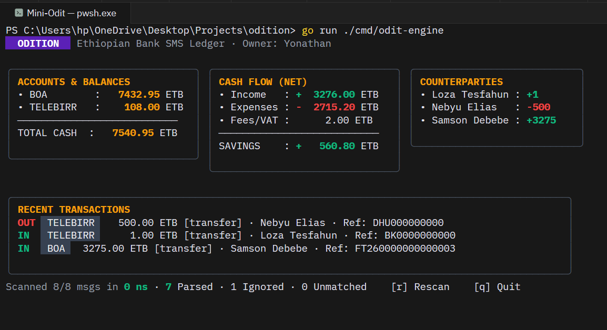

# MiniOdit

MiniOdit is a faint prototype built from first-principles to understand the pattern matching funnel and YAML regex extraction mechanics described in Odit's engineering article [[Inside the magic that makes Odit audit]](https://odit.et/engineering/inside-the-yaml-pattern-engine).


---

How It Works

A complete system like Odit implements a structured, multi-layer evaluation pipeline so that expensive regular expressions only run when strictly necessary.

### The 3-Layer Funnel

Instead of looping through dozens of heavy regular expressions on every incoming message, an SMS goes through a 3-layer filter:

1. **Layer 1: Ignored Set (`_ignored.yml`)**: An $O(1)$ hash set for static noise—OTPs, verification codes, network alerts, and generic bank security tips. If an incoming message matches, it gets dropped instantly without touching any regex.
2. **Layer 2: Exact Promo Map (`_exact.yml`)**: An $O(1)$ key-value map for known static broadcasts (holiday greetings, airtime bonuses, loan promotions). These get tagged as promos in constant time without extracting amounts or accounts.
3. **Layer 3: Ordered Pattern Engine (`patterns/`)**: Only messages that survive Layers 1 and 2 reach the regex engine. Each bank provider has declarative YAML pattern files sorted by an explicit `order` key.

---

## How Odit Does Patterns vs What We Have Here

In production, as mentioned in their writings, Odit has this whole sophisticated build-time compiler pipeline. The actual system runs **2,491 YAML files across 21 bank providers** (Telebirr alone has 501 pattern files to handle every subtle format tweak over the years). Every single YAML file is validated against a strict Zod schema at build time, compiled into strongly-typed TypeScript code, and checked against a content-hashed test corpus to detect schema drift before deployment.

Because I'm not building a full codegen compiler pipeline here, MiniOdit loads the YAML pattern files directly at runtime in Go. I am only testing a minimal set of **5 patterns across Bank of Abyssinia (BOA) and Telebirr** (debits, P2P transfers, and Amharic receipts with VAT) just to understand how it works without drowning in thousands of edge cases.

Each pattern file basically defines four things:

- **A Gating Identifier**: A quick regex check (`identifier`). If this doesn't match the SMS, the engine immediately skips to the next pattern without wasting CPU evaluating individual field regexes.
- **Targeted Field Extractors**: Small, isolated regexes capturing specific tokens (`AMOUNT`, `TXN_ID`, `SENDER_NAME`, `BALANCE`, etc.) rather than one giant fragile regex trying to capture everything at once.
- **Fallback URL Templates**: If a bank SMS gives you a transaction number but doesn't include the receipt link, you can synthesize it on the fly using token placeholders (e.g. `https://transactioninfo.ethiotelecom.et/receipt/{TXN_ID}`).
- **Domain Mapping**: Maps the extracted raw strings to financial accounting concepts—direction (`INCOMING` vs `OUTGOING`), splitting fees and nested VAT amounts, and identifying sender vs recipient.

---

## The Go Regex, RE2 vs `regexp2`

One interesting thing when implementing this in Go is the standard library `regexp` package uses **RE2**, which guarantees linear-time ($O(n)$) execution to prevent ReDoS attacks. 

The catch is that RE2 strictly does not support **lookarounds** (lookaheads/lookbehinds). In Odit, negative lookaheads (like `(?!Tip\b)`) are critical to make sure bank awareness messages (like *"Debit card tip: keep your PIN safe"*) don't trick the engine into registering a debit transaction.

And To get full lookahead support in Go without falling back to Cgo, i used [`github.com/dlclark/regexp2`](https://github.com/dlclark/regexp2).

---

## The Ledger (Built for Output)

Odit's article stops at extracting structured data from raw SMS. To actually do something with that data and see the results in action, I built a lightweight double-entry ledger aggregator. It isn't a complex relational database or heavy accounting engine; I built it simply to have a clean, verifiable output and show balance tracking from the parsed stream:

- Calculates provider-level balances across Telebirr and Bank of Abyssinia.
- Tracks net cash flow, income, and total expenses.
- Separates transfer fees and 15% VAT from the principal amount so the balance math actually reconciles.
- Aggregates counterparty profiles (recording total money sent to or received from each person).

It feeds directly into the Bubble Tea terminal interface to display the live financial cards and transaction logs.

---



## Running MiniOdit

### Terminal Interface
MiniOdit includes a compact terminal UI built with [Bubble Tea](https://github.com/charmbracelet/bubbletea):

```powershell
go run ./cmd/odit-engine
```

### Unit Tests
```powershell
go test -v ./...
```
